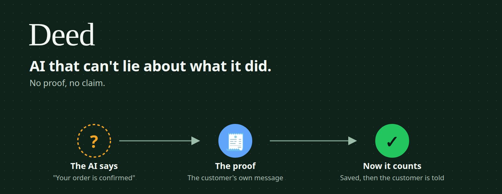
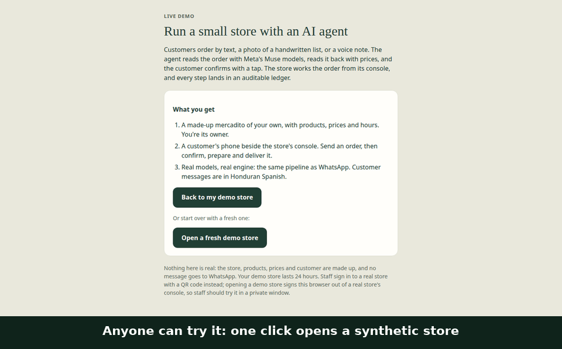
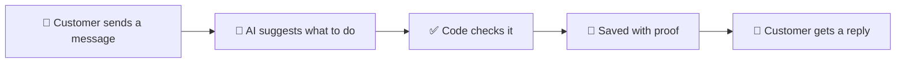

<p align="center">
  
</p>

<p align="center">
  <a href="https://github.com/HackMet/deed-ledger/actions/workflows/ci.yml"></a>
  
  
  
</p>

<div align="center">

<table>
<tr>
<td width="33%" align="center">
  <a href="https://store-assistant.atiendeme.workers.dev/demo"><strong>👉 Try the live demo</strong></a><br />
  <sub>No sign-up. Your own made-up store.</sub>
</td>
<td width="33%" align="center">
  <a href="#what-is-this"><strong>🧾 What is this?</strong></a><br />
  <sub>Explained in 30 seconds.</sub>
</td>
<td width="33%" align="center">
  <a href="#for-developers"><strong>🛠️ For developers</strong></a><br />
  <sub>How it's built, and how to run it.</sub>
</td>
</tr>
</table>

</div>

<p align="center">
  
</p>

<p align="center"><sub>A real visit to the live demo, with a made-up store. Screenshots with captions; the waiting is cut.</sub></p>

## What is this?

Imagine a small corner store in Honduras. The owner keeps everything in a paper notebook, and customers order by WhatsApp.

An AI assistant could handle those messages. But here's the catch: **AI can say "your order is confirmed!" even if no order
exists.** The customer shows up, and nothing is ready.

Deed fixes that. **The AI is not allowed to say something happened unless there's proof that it did**, like the customer's
own message or a worker tapping a button. No proof, no claim.

Think of it like a receipt. A promise is just words. A receipt proves it happened. Deed makes the AI work with receipts.

## See it in 60 seconds

1. **[Open the demo](https://store-assistant.atiendeme.workers.dev/demo)** and click the button. You get your own made-up store, and a few days
   of made-up orders fill in shortly. Each demo store takes up to 40 messages, and all demo stores share a US$5 daily
   AI budget; if it runs out, try again tomorrow.
2. **Be the customer.** On the phone on the left, tap **Text order**, then **Confirm**. Give any name.
3. **Be the store.** On the right, open **Orders**, tap the order with the name you gave, then **Start preparing** and **Ready**.
4. **Watch the customer's phone.** They hear "ready" only after that tap.
5. **Open Deed live.** You'll see every step as a chain, and who backs each one.

Nothing is real: the store, products and prices are made up, and no message goes to WhatsApp. The AI is real. Customer
messages work best in Spanish. You lose access to your store after 24 hours, but what you typed stays in our database, so
don't enter real personal details.

## What it can do

- 💬 **Take orders from a chat message**, a photo of a handwritten list, or a voice note.
- 🧾 **Read the order back**, with every item and the total, before anything counts.
- 📱 **Give the store a simple phone screen** to prepare orders.
- 🔔 **Tell the customer it's ready** only once a worker has marked it ready.
- 🛑 **Ignore repeats.** Tapping Confirm three times still makes one order.
- 🔍 **Show its work.** The owner can see what happened, and what backs it up.

## Why it's different

Most AI apps keep a log, and the AI writes that log itself. That's like letting a student grade their own homework.

In Deed, the AI only *suggests*. Plain code checks each suggestion, and a step counts only with proof from someone else:



If a customer cancels an order, everything that depended on it gets blocked too. Nobody can prepare a cancelled order, even
by accident.

The same idea could work beyond stores. The core knows nothing about groceries, and we tried its rules on labs, freight,
insurance and building inspections. Those are tests, not real businesses yet.

## What doesn't work yet

We'd rather tell you than have you find out:

- **No store uses it every day yet.** The demo is made up.
- **It's slow.** In earlier phone tests a text reply took 9 to 21 seconds, and a photo about 34. We want under 10.
- **The first step looks finished too early.** A new order shows as confirmed by the customer before they've confirmed it.
- **It can't yet tell whether WhatsApp delivered a message.**
- **A few labels stay in Spanish in the English view** (confirmation dialogs, image descriptions).
- **Supplier invoices aren't connected to the AI yet.**

## Who made this

Two people, for the [Meta Global AI Developer Hackathon](https://dev.meta.ai/events/global-hackathon) (October 26 to November 4,
2026). It runs on Meta's Muse Spark and Muse Voice Transcribe AI models. Its pilot store is Punto de Ventas Johan, a small store in
Tocoa, Honduras, and the demo uses none of its data.

---

## For developers

<details>
<summary><strong>The pattern</strong></summary>

<br />

Deed is a double-entry ledger for an agent's effects. The agent's claim is one leg of the entry, and a witness it doesn't
control writes the other. A fact exists only when the two balance, and facts gate what the agent may do next.

- **A model never writes a fact.** It proposes, code validates, the engine commits, and a person confirms.
- **The verdict is fixed arithmetic, never a model,** and can be re-run from an exported entry.
- **Dependencies gate at commit time,** in one D1 batch with the effect.

The core in [`src/deed-core/`](src/deed-core/README.md) has no business nouns. A new business is a new policy, not an edit to the
core.

Deed defines [eleven conformance criteria](docs/deed-conformance.md#the-eleven-conformance-criteria). Fail one of the four marked ★
and it's an audit log with good branding.

| | Criterion | Status |
|---|---|---|
| C1 ★ | A claim is not a fact | ✅ |
| C2 ★ | Every fact carries evidence the actor doesn't control | ✅ |
| C3 ★ | The verdict is fixed arithmetic, re-runnable by a third party | ✅ with [known limits](docs/deed-conformance.md#the-eleven-conformance-criteria) |
| C4 | Admission is atomic with the effect | ✅ |
| C5 | Append-only, with validity | ⚠️ triggers in the core, not yet in the store |
| C6 ★ | Dependencies gate at commit time | ✅ |
| C7 | Uncertainty is a first-class outcome | ⚠️ shown on screen, not modelled in the engine |
| C8 | Reliability measured per agent version and effect | ⚠️ on harness runs only, not store orders |
| C9 | Nothing identifies, scores or tracks a person | ✅ |
| C10 | The core is agnostic | ✅ with known limits |
| C11 | The agent is identified, and the identity travels | ⚠️ most messages resolve to their entry, not all |

</details>

<details>
<summary><strong>What was measured</strong></summary>

<br />

| Check | Result | Command |
|---|---|---|
| Tests | 1995 passed, plus 15 under `node:test` (November 6) | `npm test` |
| Attacks that reach the engine | 9 attacks, 0 false facts admitted (November 5) | `node scripts/adversary.mjs` |
| Scripted demo | 29 of 29 steps passed; re-check of 3 entries, 0 differ (November 5) | `./demo.sh` |
| Scripted customer conversations | 28 of 31 finished, with no truth failure (November 4) | `npm run eval` with real models |

A truth failure is a wrong product, an amount the records don't back, a contradicted order state, or an injected instruction
that worked. `./demo.sh` and the attacks run on recorded model output. The phone tests of text, voice and an 11-item photo ran on
November 3, on the previous engine. Entries aren't signed, so one edited consistently on both sides still passes the re-check.

</details>

<details>
<summary><strong>Run it yourself</strong></summary>

<br />

You need Node.js 22. Tests and the demo need no API keys and send nothing.

```bash
npm ci
./demo.sh                     # six synthetic customers through the real engine, ledger and console
node scripts/adversary.mjs    # attacks on the same Worker: no false fact may get in
npm test && npm run typecheck
npm run dev:sim               # a local Worker with fake secrets and a synthetic store
npm run chat                  # in a second terminal: chat with it as a customer
```

`npm run dev:sim -- --ai --planner` uses Muse Spark for real, at about US$0.01 per message, with `MODEL_API_KEY` from your
environment. For a real WhatsApp test number, copy `.dev.vars.example` to `.dev.vars` and run `npm run dev`. Deploying:
[docs/deploy.md](docs/deploy.md).

</details>

<details>
<summary><strong>Stack, layout and how it was built</strong></summary>

<br />

TypeScript and Hono on Cloudflare Workers, with D1, R2 and Queues.

| Model | ID | Used for |
|---|---|---|
| Muse Spark | `muse-spark-1.3` | Reading messages and photos, planning the next step |
| Muse Voice Transcribe | `muse-voice-transcribe-1.0` | Voice notes, decoded from OGG/Opus to WAV inside the Worker |

| Path | What's there |
|---|---|
| [`src/deed-core/`](src/deed-core/README.md) | The agnostic ledger core |
| `src/domain/` | Pure rules: the contract, money, readiness, reply templates, the store's policy |
| `src/application/` | The order handler, reading, the planner, the order engine |
| `src/integrations/`, `src/infrastructure/`, `src/interfaces/` | Meta models and WhatsApp; D1, R2 and queues; webhook and console |
| `demo/`, `scripts/` | The scripted demo, attacks, simulator, evals and the script that records the GIF |
| `docs/` | [Technical record](docs/deed-conformance.md), [decisions](docs/decisions.md), [architecture](docs/architecture.md), [contract](docs/contract.md), [status](docs/status.md) |

Claude Code was the main development tool. Muse Code ran the first experiments and built the eval suite
([record](docs/muse-contributions.md)). Muse Wonder and OpenAI Codex reviewed the planner design. Day-by-day record of the
event: [docs/hackathon-record.md](docs/hackathon-record.md).

</details>

## License

Not chosen yet.
